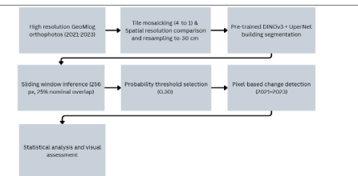

# Workflow — Khirbet al-Fakheit orthophoto analysis

The flowchart follows the provided presentation slide

## Processing stages

1. **Source selection:** GeoMOLG 2021, 2022, 2023 RGB orthophoto services; center 31.37662°N, 35.16619°E; 1 × 1 km in EPSG:28191.
2. **Tile extraction and mosaicking:** Each year consists of four 3334 × 3334 px tiles forming a 6668 × 6668 px georeferenced raster.
3. **Resolution tests:** Extract 1536 × 1536 px test patches. Downsample from ~15 cm to ~30 cm and compare predicted buildings across both resolutions.
4. **Model prediction:** Load pretrained `hotosm/dinov3s-buildings` ONNX; 256 px windows, 192 px stride and averaged overlaps. Threshold tests on patches compare 0.20, 0.30, 0.40, 0.4371 and 0.50.
5. **Full-AOI inference:** Downsample full images to 3334 × 3334 px (~30 cm), select 0.30 threshold, and export building probability and binary-mask GeoTIFFs for each year.
6. **Change detection:** Classify transitions between predicted binary building masks as stable, gain, or loss over each of three comparison periods.
7. **Statistics and visualization:** Calculate areas from pixel counts and georeferenced pixel area; create overview maps, zoom images and charts.

