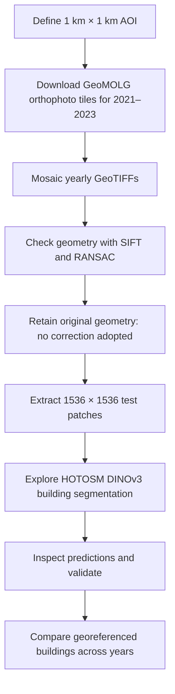

# Workflow — Khirbet al-Fakheit orthophotos (2021–2023)

This workflow tracks **completed**, **exploratory**, and **not-yet-demonstrated** stages without presenting experimental predictions as confirmed results.

## Stage log

| Stage | Status | Notes |
|---|---|---|
| AOI definition | Completed (reported) | 1 × 1 km Khirbet al-Fakheit |
| Download | Completed (reported) | GeoMOLG layers 2021/2022/2023, four tiles/year |
| Mosaic creation | Completed (reported) | 3 GeoTIFFs, each 6668 × 6668 px, EPSG:28191 |
| Image registration test | Completed as experiment | SIFT and RANSAC; no global correction adopted |
| Test patches | Completed (reported) | 1536 × 1536 px for each year |
| Model inference | Exploratory | HOTOSM ONNX workflow; verify code and outputs |
| Annual footprint maps | Not yet confirmed | Requires visual QA and georeferenced output |
| Building-change metrics | Not yet demonstrated | No independently validated area/count changes documented |

## Relationship to the regional Hebron analysis

The orthophoto study is a **local, higher-resolution case study** with a different temporal coverage (2021–2023) than the regional Sentinel-2 / Dynamic World analysis (2020–2022 vs 2026). These outputs may provide complementary evidence but are not directly comparable pixel by pixel without methodological harmonisation.
